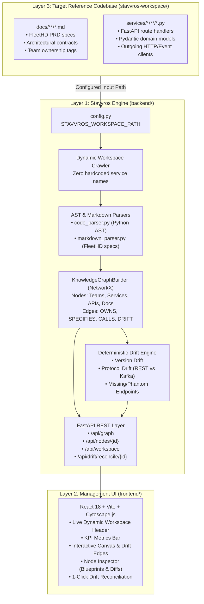

# Stavvros: Project Process, Architecture & Status Tracker

> **Document Purpose**: Living operational document tracking current system architecture, implemented capabilities, test status, verified user stories, and active engineering process for **Stavvros**.  
> **Last Updated**: October 30, 2026  
> **Project Context**: Based on [problem.md](./problem.md) and [USER_STORIES_AND_WIREFRAMES.md](./USER_STORIES_AND_WIREFRAMES.md).

---

## 1. Executive Summary & Vision

**Stavvros** is a software team memory engine and management visualization dashboard designed to solve the cross-team blindness and documentation drift problem for AI coding assistants and engineering teams.

When developers instruct AI coding assistants (e.g. adding a "refund" feature in a checkout service), the assistant only observes local files. It is blind to external services (e.g., payments service), stale PRD specifications, and cross-team architectural contracts. Consequently, the AI guesses, writes plausible code that passes superficial review, and breaks in production.

Stavvros dynamically crawls codebases and Markdown documentation, reconstructs a living knowledge graph (teams, services, APIs, domain models, and documents), deterministically detects doc-to-code drift without requiring an LLM, and surfaces this memory via an interactive dashboard and API.

---

## 2. Architectural Blueprint & Layer Separation

The codebase is strictly separated into three independent layers with **zero hardcoded domain metadata**:



### Layer Responsibilities

| Layer | Directory | Responsibility | Key Properties |
| :--- | :--- | :--- | :--- |
| **Target Codebase** | [`stavvros-workspace/`](./stavvros-workspace) | Customer repository containing microservices and documentation (`docs/` and `services/`). | Completely isolated. Can be replaced with any external repository without altering backend or frontend code. |
| **Generic Engine** | [`backend/`](./backend) | Python/FastAPI backend using NetworkX and Python AST to crawl, parse, and build memory graphs. | Zero hardcoded domain strings. Configurable via `STAVVROS_WORKSPACE_PATH`. |
| **Management Dashboard** | [`frontend/`](./frontend) | React 18 + Tailwind CSS + Cytoscape.js client. | Renders dynamically whatever graph and metadata the backend produces. |

---

## 3. Implemented Capabilities & Current Process

### A. Dynamic AST & Markdown Inference (Zero Hardcoding)
* **Code Parsing (`backend/app/parsers/code_parser.py`)**:
  * **AST Route Extraction**: Inspects route decorators (`@app.get`, `@app.post`, etc.), HTTP verbs, parameter schemas, and status codes.
  * **Tech Stack Inference**: Analyzes AST import nodes (`fastapi`, `pydantic`, `kafka`, `httpx`, `requests`, `sqlalchemy`) to dynamically generate technology tags.
  * **Service Blueprints**: Derives service mission from module-level docstrings, extracts Pydantic data schemas with field types, and synthesizes step-by-step request execution pipelines from function AST statements.
  * **Dependency Inference**: Scans string literals within function bodies and client files to infer cross-service HTTP and event dependencies.
* **Document Parsing (`backend/app/parsers/markdown_parser.py`)**:
  * Parses FleetHD PRD templates and architectural markdown files into structured models (`FleetHDSpec`).
  * Extracts Objective, Owning/Collaborating Teams, In/Out Scope, Success Criteria, and Technical Changes.
  * Extracts API contracts (`DocContract`) including method, path, sync/async expectation, and domain tags.
* **Knowledge Graph Construction (`backend/app/graph_builder.py`)**:
  * Constructs an in-memory NetworkX directed graph containing:
    * `team` nodes (dynamically discovered from PRDs and module docstrings).
    * `service` nodes (dynamically discovered from directory structures).
    * `api` nodes (inferred from code route decorators).
    * `document` nodes (inferred from `.md` files).
  * Automatically creates semantic relationships: `owns`, `specifies`, `implements`, `calls`, and `drift_flagged`.

### B. Deterministic Drift Detection (100% Local, No LLM Needed)
Implemented in [`backend/app/drift/`](./backend/app/drift/):
* **Endpoint Version Drift (`EndpointVersionDriftRule` / `DRIFT-001-VERSION`)**:
  * Detects when a PRD contract specifies an older endpoint (e.g., `POST /v1/refunds`), but code implements a migrated version (e.g., `POST /v2/refunds/async`).
* **Protocol Drift (`SyncAsyncProtocolDriftRule` / `DRIFT-002-PROTOCOL`)**:
  * Detects when a document promises a synchronous REST response, but code executes asynchronously via background event buses (e.g. Apache Kafka `HTTP 202 Accepted`).
* **Phantom & Undocumented Endpoints (`DRIFT-003-PHANTOM` & `DRIFT-004-UNDOCUMENTED`)**:
  * Flags documented endpoints missing from the codebase and undocumented endpoints exposed by the code.
* **Pluggable Extensibility**:
  * Includes a modular `LLMDriftEvaluator` interface ready for optional semantic prose reasoning in future iterations.

### C. Management Dashboard & User Experience
Implemented in [`frontend/src/`](./frontend/src/):
* **Workspace Status Bar**: Displays current workspace path, service count, document count, and active inference mode dynamically via `/api/workspace`.
* **Management KPIs Bar**: Real-time stats on total entities, cross-team services, document coverage %, and active drift alerts.
* **Interactive Cytoscape Canvas**: Custom high-contrast node styling for Teams, Services, APIs, and Documents, with glowing red edges indicating active drift.
* **Node Inspector Drawer**:
  * **Service Blueprint View**: Mission statement, inferred tech stack, execution pipeline steps, and Pydantic schema inspector.
  * **Source Code Viewer**: Raw source code browser with 1-click clipboard copy.
  * **PRD Section Viewer**: Structured FleetHD PRD viewer displaying parsed scope, success criteria, and objective.
  * **Drift Resolution**: Side-by-side diff comparing doc specification against code reality, with a 1-click reconcile button that resolves the alert and updates the graph relationship.
* **Manual Relationship Creator**: Modal allowing developers and leads to add custom edges (`calls`, `references`, `owns`) directly within the UI.

---

## 4. Verification & Testing Status

### Automated Test Suite
All 9 unit and integration tests are passing in [`backend/tests/`](./backend/tests/):

```bash
source backend/.venv/bin/activate && PYTHONPATH=backend pytest backend/tests/ -v
```

```
backend/tests/test_api_routes.py::test_api_health PASSED                 [ 11%]
backend/tests/test_api_routes.py::test_api_workspace_info PASSED         [ 22%]
backend/tests/test_api_routes.py::test_api_get_graph PASSED              [ 33%]
backend/tests/test_api_routes.py::test_api_get_node_details PASSED       [ 44%]
backend/tests/test_api_routes.py::test_api_add_edge_and_reconcile PASSED [ 55%]
backend/tests/test_drift_engine.py::test_markdown_parser PASSED          [ 66%]
backend/tests/test_drift_engine.py::test_code_parser_ast PASSED          [ 77%]
backend/tests/test_drift_engine.py::test_drift_detection_orchestrator PASSED [ 88%]
backend/tests/test_drift_engine.py::test_knowledge_graph_builder PASSED  [100%]
========================= 9 passed in 1.18s =========================
```

### Frontend Build Verification
The frontend compiles with 0 TypeScript errors and builds cleanly:

```bash
cd frontend && npm run build
# Output: ✓ built in 2.84s (dist/ generated cleanly)
```

---

## 5. Complaint & User Story Coverage

| ID | Origin in `problem.md` | User Story | Implemented Solution | Status |
| :--- | :--- | :--- | :--- | :---: |
| **C-1** | AI assistants blind to cross-team dependencies (e.g. checkout cannot see payments). | **US-1**: Understand how services connect, schemas, and execution pipelines. | Graph Canvas + Service Blueprint tab (Pydantic models, pipeline steps, tech stack). | ✅ Complete |
| **C-2** | Code-document drift causes AI to write invalid code against stale documents. | **US-2**: Detect and visually flag discrepancies between `.md` specs and code. | Deterministic AST Drift Engine (`DRIFT-001` through `DRIFT-004`) + Drift Alert Edges. | ✅ Complete |
| **C-3** | Word docs and PRDs are hard to locate, track, and share across teams. | **US-3**: Map all `.md` files to services and APIs in one unified system view. | Markdown Parser + Document Nodes in graph + Document Inspector view. | ✅ Complete |
| **C-4** | Overcomplicated PRDs cause coding assistants to wander out of scope. | **US-4**: Parse PRDs into structured sections (Objective, Scope, Criteria). | FleetHD PRD Parser + Structured section viewer in Node Drawer. | ✅ Complete |
| **C-5** | Teammates constantly interrupted to explain cross-service linkages. | **US-5**: Allow engineers to manually connect or reconcile links in minutes. | Add Edge Modal + 1-Click Drift Reconciliation endpoint (`/api/drift/reconcile/{id}`). | ✅ Complete |

---

## 6. How to Run & Operate the System

### Prerequisites
* Python 3.11+ (tested with Python 3.14)
* Node.js 18+ and npm

### 1. Start the Backend Engine
```bash
# Navigate to backend directory
cd /Users/karthik/Code/stavvros/backend

# Activate virtual environment
source .venv/bin/activate

# Optional: target any arbitrary workspace (defaults to ../stavvros-workspace)
export STAVVROS_WORKSPACE_PATH="/Users/karthik/Code/stavvros/stavvros-workspace"

# Run FastAPI server
uvicorn app.main:app --host 0.0.0.0 --port 8000 --reload
```

* **Interactive OpenAPI Docs**: [http://localhost:8000/docs](http://localhost:8000/docs)
* **Workspace Metadata API**: [http://localhost:8000/api/workspace](http://localhost:8000/api/workspace)
* **Full Graph Payload**: [http://localhost:8000/api/graph](http://localhost:8000/api/graph)

### 2. Start the Frontend Dashboard
```bash
# Navigate to frontend directory
cd /Users/karthik/Code/stavvros/frontend

# Run development server
npm run dev
```

* **Dashboard Web UI**: [http://localhost:5173](http://localhost:5173)

---

## 7. Current Project Status & Roadmap

```
Current Status: PHASE 2 COMPLETE (Engine, UI, Zero-Hardcoding, Deterministic Drift)
```

- [x] **Phase 1: Foundations & Domain Modeling**
  - [x] Customer interviews and complaints analysis (`problem.md`).
  - [x] User personas, stories, and wireframes (`USER_STORIES_AND_WIREFRAMES.md`).
  - [x] Mock target workspace representing multi-service e-commerce ecosystem.
- [x] **Phase 2: Generic Engine & Management Dashboard**
  - [x] 100% dynamic AST parser and FleetHD PRD parser.
  - [x] Complete decoupling of target reference workspace from engine/frontend.
  - [x] Local deterministic drift detection (version, protocol, phantom, undocumented).
  - [x] React 18 + Cytoscape visualization with Service Blueprints and drift reconciliation.
  - [x] 9/9 backend unit/integration tests passing; clean frontend production build.
- [ ] **Phase 3: AI Assistant Integration & Query Layer (Next Steps)**
  - [ ] **Model Context Protocol (MCP) Server**: Expose Stavvros memory graph as an MCP server so external AI assistants (Cursor, Claude, Gemini, Antigravity) can query graph context before generating code.
  - [ ] **Context Injection CLI / Tool**: Command-line tool allowing an agent to fetch `stavvros query "How does refund processing work across checkout and payment services?"`
  - [ ] **LLM Semantic Drift Evaluator**: Optional plug-in enabling deep prose policy verification (e.g. business logic constraints) via Gemini API.
  - [ ] **Multi-Repository Git Ingestion**: Automated Git webhook ingestion for multi-repo enterprise setups.
